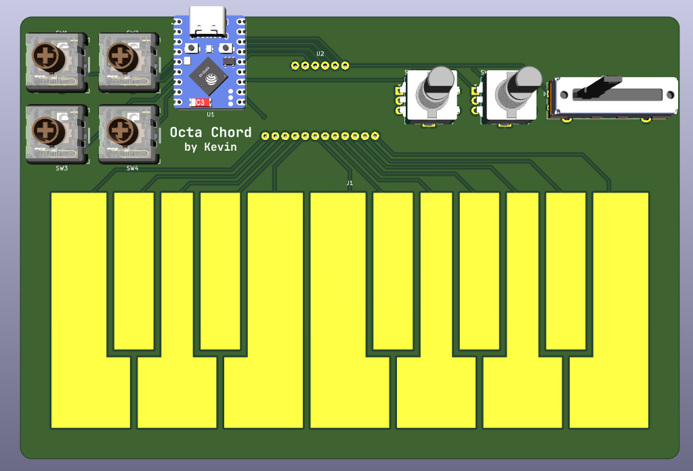
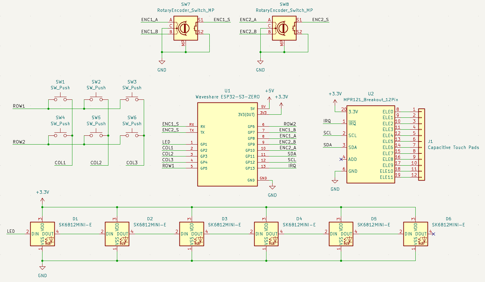
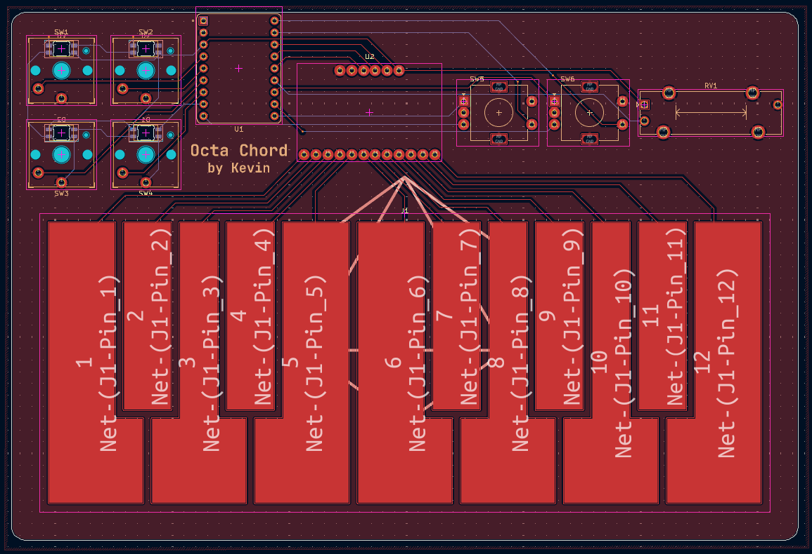

# Octa Chord

A 12-key MIDI keyboard with rotary encoders, key switches, and capacitive touch pads.

## Details
PCB made in **KiCad** 
Firmware in **KMK**

**Components**:
- **Waveshare ESP32-S3-Zero**: Microcontroller
- **MPR121 Breakout V12**: Capacitive Touch Sensor Control Module
- **Kailh Choc v1 Switches**: Key switches
- **Chocfox CFX Choc Blank Keycaps**: Keycaps
- **Hongyan EC11H 7CE20P1ZD20**: Rotary encoders

**Features**:
- **12 capacitive touch pad keys**, one octave on a piano
- **6 key switches** in a **3x2 grid**, each with an **LED**
- **2 rotary encoders** with switches
- **ESP32 microcontroller** with a **USB-C port** and **15 GPIO pins**

## About
Before making this project, I barely knew anything about MIDI, but I was curious to learn how it
worked and use it to make simple music. So, for week 3 (Music week) of Hack Club's Half Life, I
was excited to make a simple MIDI controller I could use and learn from.

My original plan was far more ambitious than the final version. See [JOURNAL.md](JOURNAL.md) for some
of the many iterations I went through of the layout and overall design. I had to make many compromises
and changes so the final product was useful, feasible, and something I could be happy with.

## Images

### Schematic

### PCB Routing

## BOM

Item  | Description  | Quantity  | Source  | Cost  | Amount
--- | --- | --- | --- | --- | ---
PCB  |  Board  |  1  |  [JLCPCB](https://jlcpcb.com/)  |  $13.20  |  $13.20
ESP32-S3-Zero  |  Microcontroller  |  1  |  [Robu](https://robu.in/product/waveshare-esp32-s3-mini-development-board-based-on-esp32-s3fh4r2-dual-core-processor-240mhz-running-frequency-2-4ghz-wi-fi-bluetooth-5/)  |  $6.40  |  $6.40
MPR121 Breakout V12  |  Capacitive Touch Sensor I2C Controller  |  1  |  [Robocraze](https://robocraze.com/products/mpr121-12-channel-capacitive-touch-sensor-controller-module-i2c-interface)  |  $1.50  |  $1.50
Kailh Choc v1 Low Profile Switches (Burnt Orange)  |  Key switches  |  1  |  [NeoMacro](https://neomacro.in/products/kailh-choc-v1-switches?variant=49466990231830)  |  $5.10  |  $5.10
Chocfox CFX Choc Blank Keycaps (1U x 10pcs)  |  Keycaps  |  1  |  [NeoMacro](https://neomacro.in/products/chocfox-cfx-choc-blank-keycaps?variant=49467026833686)  |  $3.70  |  $3.70
Hongyan EC11H 7CE20P1ZD20  |  5-Pin Vertical Rotary Encoder with Switch  |  2  |  [Robu](https://robu.in/product/hongyan-ec11h-7ce20p1zd20-rotary-encoder-with-push-button-switch-vertical-plug-in-5-pin/)  |  $0.70  |  $1.40
2.54mm 1x40 Pin Male Header Strip  |  Pin header  |  1  |  [Robu](https://robu.in/product/2-54mm-1x40-pin-male-single-row-straight-long-header-strip-pack-of-3/)  |  $0.16  |  $0.16
Estimated total shipping  |  -  |  1  |  -  |  -  |  $11.70
TOTAL  |  |  |  |  |  $43.16
