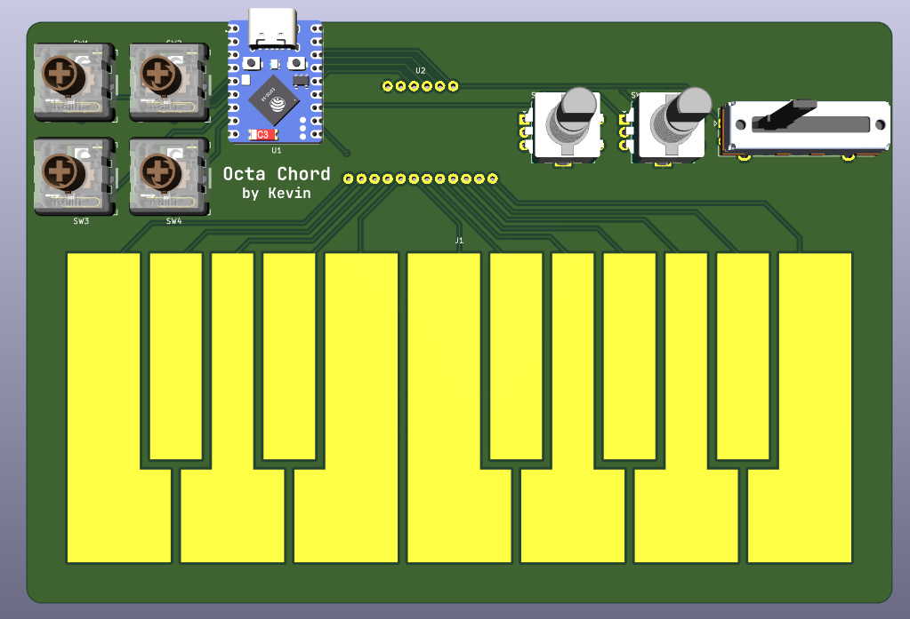
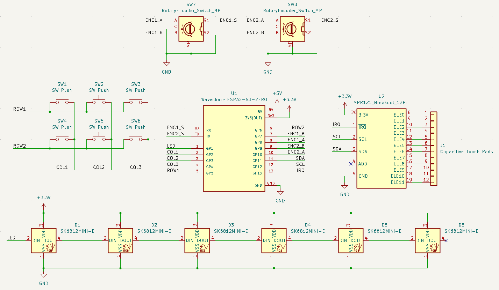
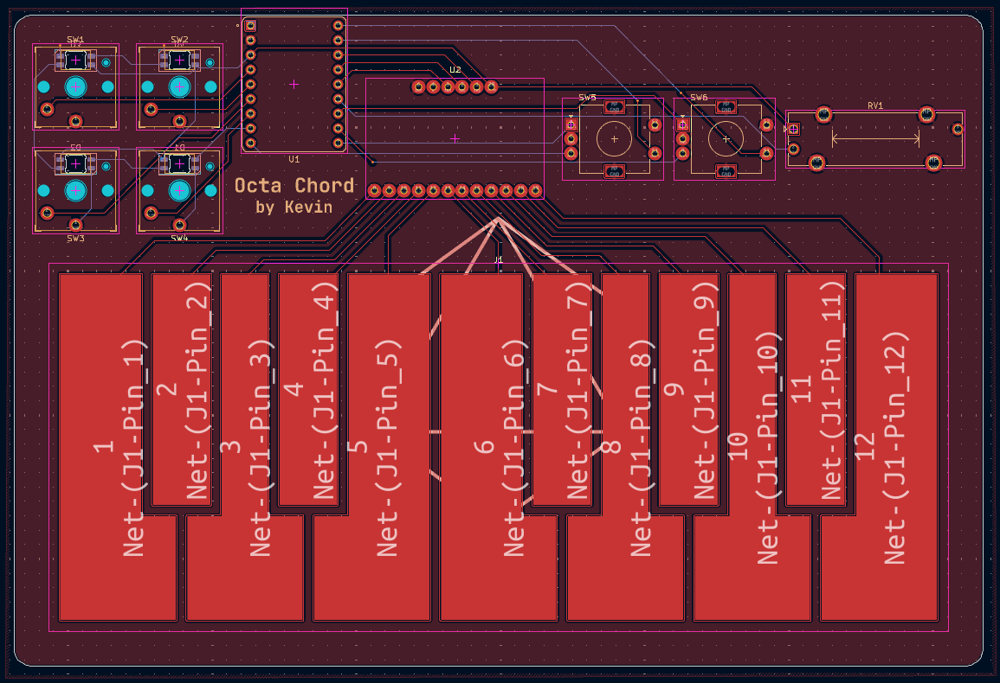

# Octa Chord

A 12-key MIDI keyboard with rotary encoders, key switches, and capacitive touch pads.

## Details
PCB made in **KiCad** 
Firmware in **KMK**

**Components**:
- **Waveshare ESP32-S3-Zero**: Microcontroller
- **MPR121 Breakout V12**: Capacitive Touch Sensor Control Module
- **Kailh Choc v1 Switches**: Key switches
- **Chocfox CFX Choc Blank Keycaps**: Keycaps
- **Hongyan EC11H 7CE20P1ZD20**: Rotary encoders

**Features**:
- **12 capacitive touch pad keys**, one octave on a piano
- **6 key switches** in a **3x2 grid**, each with an **LED**
- **2 rotary encoders** with switches
- **ESP32 microcontroller** with a **USB-C port** and **15 GPIO pins**

## About
Before making this project, I barely knew anything about MIDI, but I was curious to learn how it
worked and use it to make simple music. So, for week 2 (Music week) of Hack Club's Half Life, I
was excited to make a simple MIDI controller I could use and learn from.

My original plan was far more ambitious than the final version. See [JOURNAL.md](JOURNAL.md) for some
of the many iterations I went through of the layout and overall design. I had to make many compromises
and changes so the final product was useful, feasible, and something I could be happy with.

## Images

### Schematic

### PCB Routing

